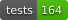
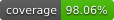

## **Krypto**

 

### Project Overview
"Krypto" is a digital implementation of the classic mathematics card game. 
This project builds Python-based executables for the Krypto game GUI that 
can run on Windows and Linux, desktop and laptop.

### How To Download and Install
Windows and Linux: There is no conventional "Install" step, just a 
download. Download the Krypto executable, put it in a folder of your 
choosing on your computer, and run the program to play it. \
The following download procedures may vary slightly depending on the 
particular version of your operating system; consult other sources for 
help if necessary. \
To download the executables, go to the latest release page on the Krypto 
GitHub repo: https://github.com/BillSousa/krypto/releases/latest \
Once on the Krypto release page:

Windows:
  - Under the "Assets" heading, find the krypto-windows.exe executable 
  and click on it. A window will come up,  
  - navigate to your desired save location (e.g. Desktop), and 
  - select "Save".

Linux:
  - Under the "Assets" heading, find the krypto-linux executable and 
  click on it. A window will come up, 
  - select "Save", another window will come up, 
  - navigate to your desired save location (e.g. Desktop), and 
  - select "Save".

### Technical Considerations 
Windows and Linux: \
The Krypto computer program is able to store the results for all the 
hands you have played. This is done via a txt file called 
"krypto_history.txt" that is stored in the same directory as the Krypto 
executable. When you run the Krypto program for the first time a new 
krypto_history file is generated automatically. If you delete the 
history file you will lose your previous results but the program will 
create a new, empty history file the next time you run it. If you move 
the Krypto executable to a new location that does not have a history 
file, the program will create a new, empty history file the next time 
you run it.

### Setting up
Windows:
- The Krypto executable for Windows should be ready to run out of the box 
without any configuration.

Linux: \
After downloading, configure permissions so that the Krypto executable 
can run on your device.
- Right-click the executable and select "Properties". Look for an entry 
called "Executable as Program", or something similar. Ensure the toggle 
is turned on. If this option does not exist under your "Properties" then 
disregard this step.
- Open a terminal in the folder where you saved the Krypto executable. 
In the terminal, run `chmod +x krypto-linux`. This permission needs to 
be set because Linux decides whether a file is allowed to run using a 
permission flag (the “executable bit”), not the file’s name or type. 
When a browser downloads a file, it creates it with default permissions 
(read/write, no execute) as a safety measure, so a downloaded program 
can’t run until someone deliberately allows it.

### How to Run the Krypto Executable
Windows:
- Double-click the executable. If antivirus software blocks the program, 
see the Troubleshooting section.

Linux:
- Do not double-click the executable. Double-clicking may show a "Failed 
  to find default application" error. Some Linux file managers don't 
  launch executables on double-click; they look for an app to open the 
  file with instead. This is a file manager behavior, not a problem with 
  Krypto.
- Right-click the file and choose "Run as a program" \
  -- or --  
  From a terminal opened in the executable's folder: `./krypto-linux`

### The Gameplay Interface / How to Play a Game
The Krypto interface is a single window that displays immediately when 
the program is launched using the procedures given directly above.

In the upper right-hand corner are 2 buttons, "Stats" and "How To Play".
- "Stats": This button is only available when a game is not running and 
is grayed out during a game. When clicked, a new window pops out that 
summarizes results from previous games. Stats can only be calculated 
when the krypto_history.txt file exists and is in the same folder as the 
Krypto executable. See the Technical Considerations section, above. If 
the history file does not exist, placeholder values are displayed in the 
absence of actual numbers.
- "How To Play": This button is only available when a game is not running 
and is grayed out during a game. When clicked, a new window pops out that 
provides a brief, non-technical summary of how this version of Krypto is 
played. See the House Krypto Rules section, below, for that exact same 
summary. The technical summary of how this Krypto game is played is what 
you are reading right now.

In the lower left-hand corner are 2 buttons, "Start New Game" and "Exit".
- "Start New Game": This button is only available when a game is not 
already in progress and is grayed out during a game. When clicked, the 
play area is activated with a fresh draw from the digital Krypto deck 
and the timer starts counting.
- "Exit": This button is available at all times. When clicked while a 
game is not running, the game window is simply closed without any change 
to the krypto_history.txt file. When clicked while a game is running, 
the game is stopped, a score of 0 is recorded to the history file, and 
the game window is closed. The "X" button in the upper right of the game 
window also has the same functionality.

The center of the play area activates when "Start New Game" is clicked. 
The digital Krypto deck is shuffled, the target card is drawn off the 
top, and the 5 hand cards are drawn.
- Top-most in the game play area is the "Target". On the same line to the 
far right, the timer begins to count upward.
- The next line presented in the play area is the "Hand", which is the 
5-card deal from the digital Krypto deck.
- Directly below the "Hand" line are the "Ops" operators, which are the 
mathematical operators and parentheses used in conjunction with the 
"Hand" cards to build an expression. **Click (not drag, not type) the 
number and operator symbols (+ - * /) to construct a valid expression 
that evaluates to the "Target" exactly.** The Krypto program has some 
basic understanding of what constitutes a valid mathematical expression. 
It will gray out invalid next characters and leave valid characters 
available as you construct the expression.
- Below the "Ops" line is the "Expr" line, the real-time display of the 
expression as it is being built.
- Finally, directly below the "Expr" line are 4 buttons: "Clear", "Undo", 
"Submit", and "Give Up".
  - If you want to restart your expression from scratch, click "Clear" 
  to wipe the entire expression area in one click.
  - If you want to remove the last character selected, click "Undo".
  - **Click "Submit" when you are ready to submit your final expression. 
  The Krypto program will compute the result of your expression and 
  compare it against the target.**
    - If the expression is malformed, an error message is displayed at 
    the bottom of the gameplay area.
    - If the output of the expression matches the target, the game is 
    ended, the timer is stopped, a congratulatory message is displayed 
    at the bottom of the play area showing your final time, and the 
    result of the game is logged to the krypto_history.txt file.
    - If the output and the target do not match, the game continues 
    and a message is shown at the bottom of the play area informing of 
    the error and the actual calculated output of the expression.
  - "Give Up" exits the round and records a score of 0.

### House Krypto Rules 
**Note:** The exact information presented below can be found in the 
built-in Krypto game instructions. (On the Krypto game interface, in the 
upper right-hand corner, locate the "How To Play" button.)
- Each round deals a target number and five hand cards (1 to 25) from a 
  56-card deck.
- Combine the hand cards with the arithmetic operators (+ - * /) and
  parentheses to make an expression that equals the target exactly.
- Each hand card can only be used once. You do not have to use all five
  cards. Your score is the number of cards you used, from 1 to 5.
- Negative and fractional values are allowed in the middle of a calculation.
  Only the final result has to equal the target.
- "Give Up" and "Exit" end the round with a score of 0.
- The timer counts up from the moment you click Start New Game, and stops 
  when you solve the round or give up.

### Troubleshooting

#### Windows

**Security software warnings:** \
Krypto is not code-signed, and it is built with PyInstaller. Antivirus 
tools often flag new, unsigned programs from unknown publishers, so these 
warnings are common and do not mean the file is harmful. You may see up 
to three kinds of prompts:

**1. Norton blocks or quarantines the .exe** \
When Norton shows its alert, choose the option to allow, trust, or keep 
the file (wording varies by version). If Norton already quarantined it, 
open Norton → Security History, find krypto-windows.exe, and choose 
Restore & Exclude (or Allow). Then run it again.

**2. Windows Defender SmartScreen says "Windows protected your PC"** \
Click "More info", then "Run anyway".

**3. Norton blocks Krypto from writing krypto_history.txt** \
After a game, Krypto saves the result to krypto_history.txt, which Norton 
may treat as suspicious file activity. When the prompt appears, choose 
Allow. To stop it from asking again, add krypto-windows.exe to Norton's 
exclusions or trusted programs list.

**Tip:** \
keep krypto-windows.exe in its own folder (for example,
C:\Users\YourName\Documents\krypto) rather than Downloads, so the history
file has a stable home.

**To verify your download:** \
Compare its SHA-256 hash to the one listed next to the file on the Krypto 
GitHub release page. In PowerShell: `Get-FileHash krypto-windows.exe`

#### Linux

**Permission issues:** \
After downloading, make the file executable before running it: \
run `chmod +x krypto-linux` in the folder where you saved the Krypto 
executable.

**The program gives me an error when I double-click it:** \
Do not double-click the executable! Right-click the file and choose "Run 
as a program".

### README Changelog
26_11_15: First release

